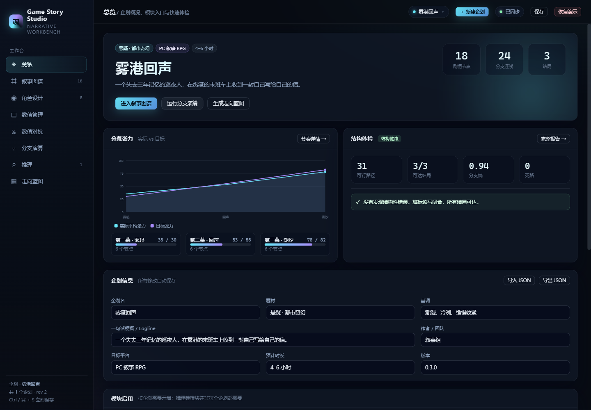
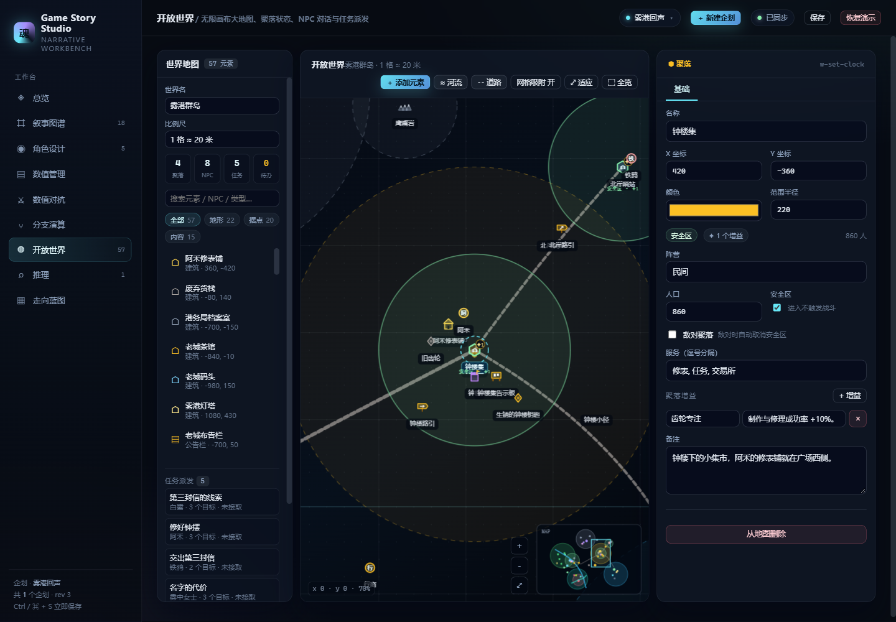
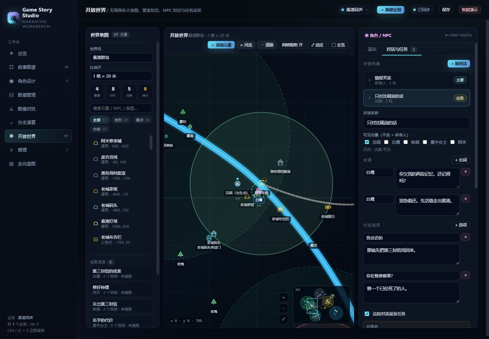
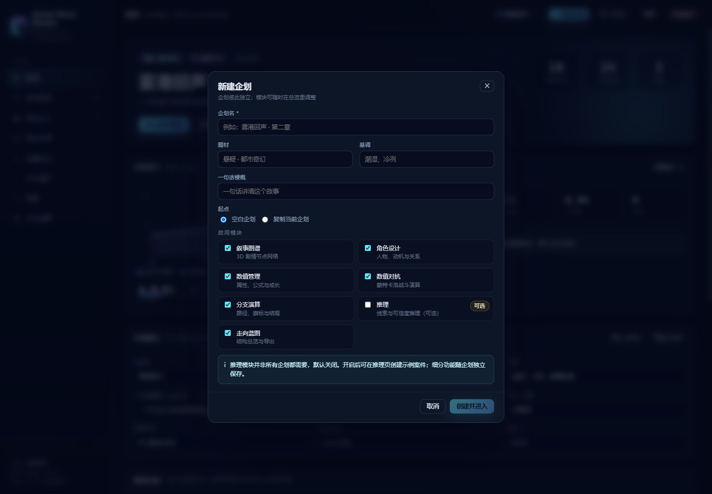
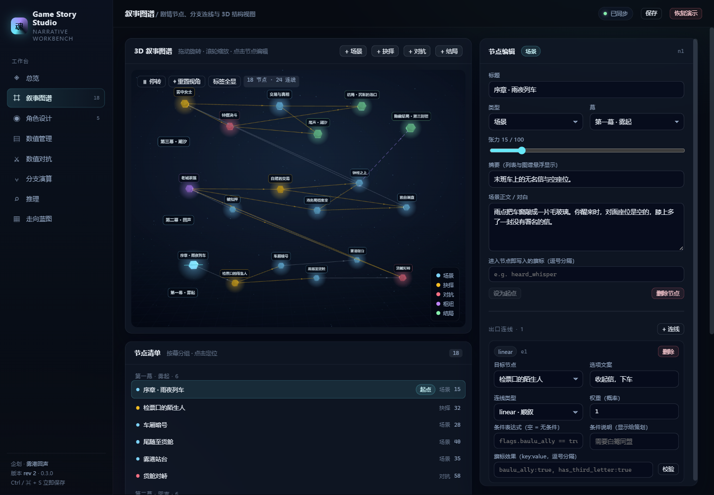

# Game Story Studio · 游戏叙事设计工作台

面向叙事策划、系统策划与独立开发者的本地一体化工作台：**剧情叙事 · 角色设计 · 数值管理 · 数值对抗 · 分支演算 · 开放世界 · 推理 · 走向蓝图 · 历史版本 · 导入导出**。

支持 **多企划工作区**（新建 / 切换 / 删除 / 复制）、**按企划启用模块**（推理等模块默认关闭，不强迫每个企划都使用）。

技术栈：**Node.js（原生 HTTP API）+ Vue 3（SFC / Composition API）+ Three.js（3D 叙事图谱）**，数据落地为 JSON 文件，零数据库、零后端框架依赖。



## 功能地图

| 模块 | 能做什么 |
| --- | --- |
| **总览 Dashboard** | 企划信息（题材 / 基调 / logline / 平台 / 版本）、节点与结局 KPI、分幕张力曲线、结构体检、JSON 导入导出 |
| **叙事图谱 Narrative** | Three.js 3D 图谱（分幕分层、抉择/对抗/结局/枢纽配色、条件虚线、方向箭头）、节点增删改、起点设置、出口连线、条件表达式校验、旗标效果 |
| **角色设计 Characters** | 角色卡与程序化徽记、动机 / 缺陷 / 弧光、基础值 × 等级成长、派生属性实时预览、技能勾选、关系网 |
| **数值管理 Stats** | 属性体系（基础 / 派生 / 指标）、安全表达式引擎、公式实验室、拓扑排序求值、Lv1–N 成长曲线与成长异常预警 |
| **数值对抗 Combat** | 回合制伤害模型、技能权重 / 冷却 / 多段 / 暴击 / 闪避、蒙特卡洛胜率、回合分布、对抗矩阵、等级胜率曲线、单场回放 |
| **分支演算 Branches** | 可达性、路径枚举与概率质量、结局覆盖、旗标读写闭合、死路 / 环 / 假选择 / 分支爆炸检测、枢纽介数中心度、逐步演算 |
| **开放世界 World** | **无限画布大地图**：聚落（敌对 / 安全区 / 增益）、NPC 角色、建筑、树木、河流、山川、重要据点、收集物、特殊区域、公告栏、路引、传送门；NPC 通用 / 特定对象对话、分支选项、任务派发；**撤销 / 重做**、世界体检 |
| **推理 Inference** | **可选模块**：可信度（CF）前向链、线索开关假设、嫌疑排序、矛盾检测、待补线索提示、规则覆盖率、推理链时间线 |
| **走向蓝图 Blueprint** | 分幕结构编辑、节奏曲线、关键节拍、结局覆盖、风险清单、角色弧光、Lv1/5/10 数值锚点，一键导出 Markdown |
| **历史版本 History** | 自动保存快照 + 手动检查点、版本时间线、跨版本模块对比、实体增删改明细、影响范围与风险提示、一键回退 |
| **导入导出 Transfer** | 专有 `.gstory` ZIP 存档（manifest + project + 校验哈希）、导出/导入、冲突预检、引用校验、复制或覆盖导入 |

演示企划《雾港回声》包含 18 个剧情节点、24 条连线、31 条可行路径、3 个结局、5 个角色、14 条属性、4 个指标公式、14 条推理规则，以及一张 **57 个元素的开放世界地图**（4 个聚落、8 个 NPC、5 个任务、2 个传送门），打开即可体验全部模块。新建空白企划会自动带一套通用属性/技能模板，并默认关闭推理模块；之后可在总览的「模块启用」里随时打开。









> 详细数据模型、引擎接口与扩展点见 [docs/ARCHITECTURE.md](docs/ARCHITECTURE.md)。

## 快速开始

环境：Node.js ≥ 18（推荐 20/22）。

```bash
npm install

# 开发模式：API 3087 + Vite 5173（热更新）
npm run dev

# 生产模式：构建后由 Node 单进程同时提供 API 与静态站点
npm run build
npm start                 # http://127.0.0.1:3087
```

- 端口可用环境变量覆盖：`PORT=4000 npm start`（Windows：`$env:PORT=4000; npm start`）。
- 数据目录：`data/projects/<企划ID>.json`，版本快照在 `data/history/<企划ID>/`；首次运行会把旧的 `data/project.json` 自动迁移为演示企划，没有旧数据则自动播种《雾港回声》。
- 所有编辑 **自动保存**（650ms 防抖），`Ctrl / ⌘ + S` 立即保存；多窗口同时编辑同一企划会通过 revision 冲突检测避免静默覆盖。
- 每次自动保存会生成历史版本（自动保留最近 60 个）；手动检查点固定保留。
- 顶栏「企划名 ▾」可切换 / 删除企划，右侧「＋ 新建企划」打开创建向导；恢复演示只在演示企划下出现。

### 新建企划与可选模块

新建向导支持：

- 填写企划名、题材、基调、一句话梗概；
- 从**空白企划**开始（带一个可改名的初始角色、一个开场节点、通用属性/战斗预设），或**复制当前企划**；
- 在创建时勾选启用模块：叙事图谱 / 角色设计 / 数值管理 / 数值对抗 / 分支演算 / 开放世界 / 走向蓝图 / 推理。

**推理默认关闭**：没有推理玩法的企划不会看到推理入口；开启后如果还没有案件，推理页会提供「创建示例案件」快速起步。关闭的模块只从侧栏隐藏，数据仍保留，可随时在总览重新开启。

### 五分钟体验路径

1. 顶栏点「＋ 新建企划」，填一个名字、取消勾选推理 → 进入一个只有开场节点的空白企划，确认侧栏没有「推理」。
2. 回到总览的「模块启用」，勾选「推理」→ 侧栏出现推理；进入后点「创建示例案件」跑一次推理。
3. 用项目切换器回到《雾港回声》，打开 **叙事图谱**，旋转/缩放 3D 图，点击节点 → 修改张力或连线条件。
4. 打开 **开放世界**：拖拽平移 / 滚轮缩放无限画布；点击白鹭 → 「对话与任务」，切换视角为沈砚，查看专属对话、分支和「第三封信的线索」任务；点击钟楼集查看安全区、增益与人口。
5. 在开放世界工具栏「＋ 添加元素」放置建筑 / 树木 / 传送门，或用「河流 / 道路」在地图上点击绘制路径，`Esc` 取消、`Enter` 完成；`Ctrl/⌘ + Z` 撤销、`Ctrl/⌘ + Shift + Z` 重做。
6. 打开 **分支演算 → 逐步演算**，点「随机走一条路线」，看旗标如何累积、隐藏结局如何被双旗标解锁。
7. 打开 **数值对抗**，点「开始演算」看胜率/回合分布，再「计算矩阵」找强弱关系。
8. 打开 **推理**，取消勾选「缺页账本」，观察结论如何退回「推理未闭合」，并读取「待补线索」。
9. 打开 **走向蓝图**，展开 Markdown 预览并下载交付文档（含开放世界摘要）。
10. 打开 **历史版本**：版本时间线选择 A/B，查看变化模块、实体明细与影响范围；创建检查点或回退到旧版本。
11. 打开 **导入导出**：导出 `.gstory`，再把文件拖回导入区，查看冲突预检（ID/名称/引用）后复制为新企划或覆盖。

## 工程结构

```text
game-story/
├─ server/
│  ├─ index.js              # HTTP 服务：企划 CRUD + 引擎 API + 静态资源托管
│  ├─ store.js              # 多企划文件、原子写入、revision、旧数据迁移
│  ├─ seed.js               # 演示企划 + 空白企划模板 + 模块默认值
│  ├─ engines/
│  │  ├─ expr.js            # 安全表达式引擎（无 eval / new Function）
│  │  ├─ stats.js           # 等级成长、派生属性拓扑求值、曲线体检
│  │  ├─ combat.js          # 回合制演算、蒙特卡洛、对抗矩阵
│  │  ├─ branch.js          # 路径枚举、概率质量、旗标/环/死路/中心度
│  │  ├─ infer.js           # CF 前向链、待补线索、矛盾检测
│  │  ├─ world.js           # 开放世界体检：元素/聚落/NPC 对话/任务/传送门引用
│  │  ├─ version.js         # 版本差异：模块、实体、影响范围
│  │  ├─ gstory.js          # .gstory ZIP 打包/解析、哈希与导入冲突预检
│  │  └─ blueprint.js       # 结构评分、张力曲线、Markdown 生成
│  ├─ versions.js           # data/history/<id>/ 版本索引与快照
│  ├─ atomic.js             # Windows 文件锁重试的安全写入
│  └─ tests/run.js          # 引擎与模块自测（33 项）
├─ web/
│  ├─ index.html
│  ├─ vite.config.js
│  └─ src/
│     ├─ App.vue            # 侧栏 + hash 路由 + 企划切换/新建 + 保存状态
│     ├─ api.js / store.js  # RPC 封装、多企划状态、防抖保存、演算前落盘
│     ├─ styles.css         # 设计系统（深色雾港主题）
│     ├─ worldTypes.js       # 13 类地图元素默认值与分类
│     ├─ components/        # Graph3D · LineChart · Avatar · WorldCanvas · WorldInspector
│     └─ views/             # 11 个业务视图（含历史版本与导入导出）
├─ scripts/                 # dev 启动、CDP 验收截图、多企划/开放世界 UI 验收、沙箱修复
├─ mcp/                     # 零依赖 MCP stdio 服务 + 配置说明 + 工具定义
├─ data/projects/           # 运行时企划数据（自动创建，按企划分文件）
├─ data/history/            # 版本索引与快照（自动保留最近 60 个自动版本）
└─ dist/                    # 构建产物
```

## API 摘要

所有接口以 `/api` 为前缀，JSON 进出。

| 方法 & 路径 | 作用 |
| --- | --- |
| `GET /projects` | 企划列表（含节点/角色/案件计数、模块开关、更新时间） |
| `POST /projects` | 新建企划：`{name, meta, modules, template: "blank"｜"clone", cloneFrom}` |
| `GET /projects/:id` | 读取指定企划 + revision |
| `PUT /projects/:id` | 保存 `{project, baseRevision}`；版本不匹配返回 409 |
| `DELETE /projects/:id` | 删除企划（至少保留一个） |
| `POST /demo/reset` | 重建演示企划《雾港回声》 |
| `POST /engine/stats` | `{projectId, characterId, level, maxLevel}` → 派生属性、指标、曲线、属性校验 |
| `POST /engine/formula` | `{projectId, expr, characterId?, level?, vars?}` → 安全求值 + 变量列表 |
| `POST /engine/combat/simulate` | `{projectId, aId, bId, levelA, levelB, presetId, config, oneShot}` |
| `POST /engine/combat/matrix` | `{projectId, ids, level, runs}` → 两两胜率矩阵 |
| `POST /engine/combat/level` | `{projectId, aId, levels[]}` → 等级胜率曲线 |
| `POST /engine/branch` | `{projectId, narrative?, options?}` → 完整分支演算结果 |
| `POST /engine/branch/route` | `{projectId, edgeIds[]}` → 按指定路线逐步演算旗标 |
| `POST /engine/infer` | `{projectId, caseId, clueOverrides?}` → 推理结果（推理未启用时前端不调用） |
| `POST /engine/world` | `{projectId}` → 世界统计、聚落状态、任务/对话覆盖、传送门与引用告警 |
| `POST /engine/blueprint` | `{projectId, format?: "md"}` → 蓝图对象或 Markdown |
| `GET /projects/:id/versions` | 版本索引（自动/手动/导入/回退、revision、大小、摘要） |
| `GET /projects/:id/versions/compare?a=&b=` | 两个版本的模块差异、实体明细与影响范围 |
| `POST /projects/:id/versions` | 创建手动检查点 `{label}` |
| `POST /projects/:id/versions/:versionId/restore` | 回退到指定版本 `{baseRevision}`；冲突返回 409 |
| `GET /projects/:id/export` | 下载 `.gstory` 压缩包 |
| `POST /projects/import/preview` | 原始 `.gstory` 请求体 → 校验、冲突、建议名称 |
| `POST /projects/import?mode=copy\|overwrite` | 导入为新企划或覆盖现有企划 |

所有引擎接口都要求 `projectId`；前端在每次调用前会先 flush 未保存的修改，避免「刚改完就演算」读到旧快照。

## MCP 接入（DSH / Claude Code / Cursor）

仓库自带一个**零第三方依赖**的 MCP stdio 服务，把企划、世界地图、聚落状态、NPC 对话/任务、世界体检与蓝图暴露为 12 个工具。MCP 进程调用本地 REST API，因此需要先启动 Web 服务。

```bash
npm start        # API 3087
npm run mcp      # 手动验证 stdio 服务
```

在 harness 的 MCP 配置里加入：

```json
{
  "mcpServers": {
    "game-story": {
      "command": "node",
      "args": ["D:/path/to/game-story/mcp/server.mjs"],
      "env": { "GAME_STORY_API": "http://127.0.0.1:3087" }
    }
  }
}
```

主要工具：`project_list` / `world_get` / `world_add_element` / `world_update_element` / `world_remove_element` / `world_set_settlement` / `world_set_npc_dialogue` / `world_analyze` / `blueprint_markdown`。完整参数、示例与约束见 [mcp/README.md](mcp/README.md)。

写操作会立即保存并递增 revision；若页面同时编辑同一企划，MCP 遇到 409 会自动重读重试一次，仍冲突时返回可操作的错误。

## 引擎要点

- **表达式安全**：自研 tokenizer + Pratt parser，支持算术/比较/逻辑/三元/成员访问/内置函数（`min`、`clamp`、`round`、`if`、`has` 等），不使用 `eval`。所有条件、派生公式、指标共用同一套语法。
- **派生属性**：按依赖关系 Kahn 拓扑排序，循环依赖与未知变量会显式报错；等级成长 = `base + growth × (level - 1)`，并受 `min/max` 约束。
- **战斗模型**：伤害 = `atk × power × 100/(100+def) × 暴击 × 波动`，命中率 = `acc - dodge`，速度决定出手顺序；Monte Carlo 使用种子随机保证可复现。
- **分支演算**：以「不重复节点的简单路径」枚举到结局/死路，边权重归一化为概率；同时做可达性 BFS、Tarjan 回路、旗标读写闭合、Brandes 介数中心度、Shannon 分支熵与张力剖面。条件表达式按当前路径旗标求值，因此隐藏分支不会被误判为不可达。
- **推理机**：事实/线索/人物特质 → 规则，结论 CF 取 `规则CF × 前提最小CF`，同类结论用 `a+b-ab` 合成；支持排除、矛盾检测、只差一个前提的「待补线索」提示。
- **开放世界**：地图元素统一为 `{type, x, y, radius|points, data}`；聚落独立维护 `hostile / safeZone / buffs` 三个正交状态；NPC 对话按 `audienceIds` 过滤（空 = 所有人），选项作为分支回应，任务挂在对话上；体检引擎检查角色/剧情节点/传送门引用、空对话、敌对与安全区冲突等。
- **历史版本**：每次保存按内容哈希去重写入 `data/history/<id>/`，自动版本保留最近 60 个、手动检查点固定保留；差异引擎按模块比较实体与字段，并基于叙事/角色/数值/世界引用关系推导影响范围。
- **.gstory**：ZIP（deflate）内含 `manifest.json`、`project.json`、`README.txt`；manifest 记录格式版本、revision、模块与 SHA-256 校验；导入前做 ZIP 完整性、哈希、ID/名称冲突与引用检查，支持复制为新企划或显式覆盖。
- **蓝图**：幕目标 vs 实际张力偏差、幕间骤降/突跳、空幕、死路、结局覆盖、分支熵、路径规模等规则合成为风险清单；关键节拍按 `扇出 × 张力 × 中心度` 排序。

## 测试与验收

```bash
npm test                  # 33 项自测：表达式 / 数值 / 战斗 / 分支 / 推理 / 蓝图 / 开放世界 / 版本差异 / .gstory / 多企划
npm run check:sensitive   # 扫描密钥、令牌、邮箱、个人绝对路径
node scripts/audit.mjs    # 需本机 Chrome 开启 CDP 9333；逐路由截图 + 控制台错误
node scripts/qa-projects.mjs  # 多企划 UI 验收：新建、模块开关、推理空态、清理
node scripts/qa-world.mjs     # 开放世界 UI 验收：地图、NPC 对话、聚落状态、全览
node scripts/qa-world-edit.mjs # 编辑验收：空世界、添加元素、绘制河流、敌对联动（临时企划，自动清理）
node scripts/qa-world-undo.mjs # 撤销/重做验收：添加、重命名、删除与键盘快捷键
node scripts/qa-history-transfer.mjs # 历史版本对比/回退与 .gstory 导出 UI 验收
npm run mcp                   # 启动 MCP stdio 服务（另开一个终端）
```

`scripts/audit.mjs` 会把 13 项路由/交互检查的截图写入 `artifacts/`（该目录已被 Git 忽略），并输出运行时报错列表（当前为 0）。

## 隐私与数据

- **纯本地工具**：无登录、无遥测、默认只监听 `127.0.0.1`，项目数据不会离开本机。
- **运行数据不入库**：`data/`、`artifacts/`、`dist/`、`.env*`、密钥文件与依赖目录均已写入 `.gitignore`；仓库只保留代码、文档与演示截图。
- **演示内容虚构**：角色、剧情、数值与推理案件均为演示数据；文档截图取自演示企划，已重新封装 PNG（剔除可能存在的文本/时间元数据）。
- **无凭据依赖**：应用不需要 API Key 或账号。若扩展外部服务，请使用环境变量，切勿提交 `.env`、token 或私钥。
- **MCP 仅本地**：MCP stdio 服务不监听网络端口，只连接 `127.0.0.1` 的本地 API；它拥有修改本地企划的权限，请只接入可信 harness，不要把服务暴露到公网。
- **提交前自检**：

  ```bash
  npm run check:sensitive
  # 或只扫描暂存区
  git grep -nI -E "api[_-]?key|secret|password|token|BEGIN (RSA|OPENSSH|PRIVATE)|C:\\\\Users|/home/" --cached
  ```

## 本机沙箱说明（仅影响当前环境）

当前执行环境禁止子进程管道，Vite/esbuild 的原生服务会以 `EPERM` 失败。项目已做三处适配：

1. `vite.config.js` 关闭 esbuild 转译/压缩，`--configLoader runner` 避免配置打包；
2. `vue` 别名到预构建浏览器 ESM，避免 define 替换触发 esbuild；
3. `node_modules/vite` 中跳过 Windows `net use` 探测（不进入仓库）。重新安装依赖后如构建报 `spawn EPERM`，运行：

```bash
npm run fix:sandbox
```

普通开发机/CI 无此限制，无需执行上述步骤。

## 后续可扩展

- 多项目分组 / 归档与版本分支/合并；
- 节点拖拽手动布局与自动布局切换；
- 角色立绘生成与关系图 3D 化；
- 战斗技能编辑器与状态效果（DoT / 护盾 / 控制）；
- 蓝图导出 PDF / PPT，推理案件可视化编辑器与规则 DSL 校验；
- 剧情试玩模式（把分支演算接到实际对白播放器）；
- 按企划自定义模块组合（例如「没有战斗」的纯叙事企划）。
